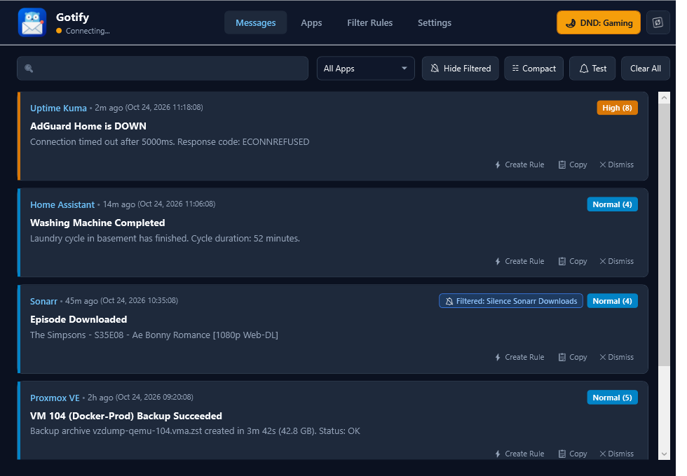
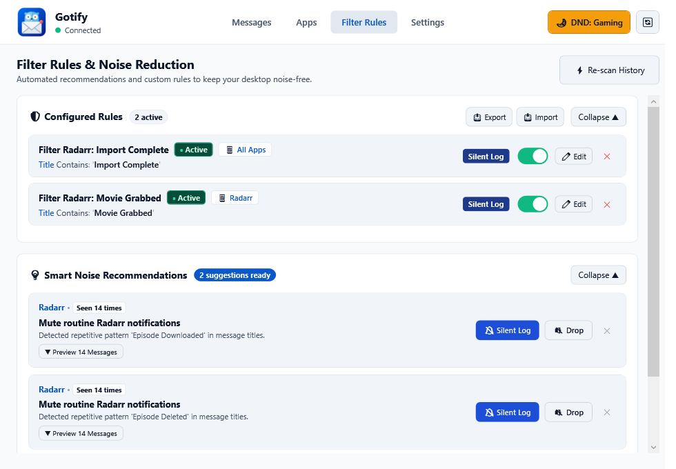

<p align="center">
  
</p>

<h1 align="center">GotifyWin</h1>

<p align="center">
  <strong>A sleek, minimal, and deeply configurable <a href="https://gotify.net">Gotify</a> push notification client designed for Windows 11.</strong>
</p>

<p align="center">
  <a href="https://github.com/roscocheeta/gotify-win-client/actions/workflows/ci.yml"></a>
  <a href="https://github.com/roscocheeta/gotify-win-client/actions/workflows/codeql.yml"></a>
  <a href="https://github.com/roscocheeta/gotify-win-client/releases"></a>
  <a href="LICENSE"></a>
  <a href="https://microsoft.com/windows"></a>
  <a href="https://dotnet.microsoft.com/"></a>
</p>

GotifyWin is built specifically for homelab operators, sysadmins, and developers who route notifications from **Home Assistant, Uptime Kuma, Proxmox, TrueNAS, Docker, Sonarr, Plex, and CI/CD pipelines** to their Windows 11 desktop.

Unlike legacy tray wrappers, GotifyWin brings **Windows 11 Fluent 2 aesthetics**, a **4-tier granular filtering engine**, an **ultra-sleek floating HUD overlay**, and an intelligent **Do Not Disturb (DND) suite**.

---

## 🚀 Quick Download & Install

You do **not** need to install the .NET SDK or any dependencies to use GotifyWin.

1. Head to the **[Latest Release](https://github.com/roscocheeta/gotify-win-client/releases/latest)** page.
2. Download **`GotifyWin-v1.0.0-win-x64-standalone.zip`** (self-contained, runs out of the box).
3. Extract the folder and launch `GotifyWin.exe`.
4. Enter your Gotify server URL (e.g. `https://gotify.homelab.lan`) and Client Token.

> [!NOTE]
> **Windows SmartScreen Notice**: Because GotifyWin is a freshly released open-source project without a paid corporate signing certificate, Windows SmartScreen may display an *"Unrecognized app"* warning on first launch. Click **More info** $\rightarrow$ **Run anyway**. You can verify our full test suite and inspect all source code directly here on GitHub.

---

## 📸 Screenshots & UI Overview

### 🌙 Dark Mode — Message History Feed


### ☀️ Light Mode — Filter Rules & Smart Noise Recommendations


---

## Key Features

### 📱 Selective App Management
* **App Auto-Discovery**: Automatically syncs applications from your Gotify server (`GET /application`).
* **Per-App Controls**: Toggle notifications per application on/off with one click.
* **Local Icon Caching**: Automatically downloads and caches application icons (`/application/{id}/image`) so notifications display service logos (Home Assistant, Docker, Uptime Kuma, etc.).
* **Per-App Priority Thresholds**: Configure individual minimum priority filters per application.

### ⚡ Intelligent Noise Reduction & Filter Rules
* **Automated Pattern Detection**: Analyzes local notification history using deterministic variable-masking clustering (normalizes timestamps, durations, numbers, IPs, and hashes) to detect repetitive operational noise (minimum 5 occurrences).
* **💡 Smart Noise Recommendations**: 1-click `[🔕 Silent Log]` (suppresses desktop popups/chimes while keeping the record) or `[🔇 Drop]` directly from automated suggestion cards.
* **⚙️ Manual Rule Builder**: Multi-condition rules targeting Application, Field (Title, Message, Application Name), and Operators (Contains, StartsWith, EndsWith, Exact Match, Regex) with custom actions.
* **⚡ 1-Click Rule Creation**: Click "Create Rule" on any past notification in history to instantly pre-fill the builder with its application name and patterns.
* **Audit Tagging & Log Flagging**: Silently logged messages are visibly tagged in the feed with an interactive badge (`🔕 Filtered: <RuleName>`), providing complete transparency.
* **Safety First**: Intelligent safeguards prevent muting high-priority alerts ($\ge 7$) or notifications containing failure keywords (`error`, `down`, `critical`, `failed`, `corrupt`).
* **Anti-Spam / Flap Debounce**: Deduplicates flapping monitor alerts within a configurable time window (3s–60s) with duplicate counters (`x5`).

### 🗂️ Message History Feed
* **Dual Layout Modes**:
  * **Detailed View**: Rich multi-tier cards with service icons, priority tags, full markdown text, attached image thumbnails, and one-click action buttons.
  * **Compact View**: High-density 36px single-line layout displaying 4× more notifications on screen with inline action buttons.
* **Hide Filtered Messages**: One-click header toggle (`🔕 Hide Filtered`) to instantly hide silenced/dropped messages from view.
* **Full Search & Filter**: Real-time keyword search and per-application filtering.

### 🔔 Maximum Presentation Customization
* **Delivery Modes**:
  * **Custom Fluent HUD Banner (Recommended)**: An ultra-clean, rounded, borderless floating window with Mica/Acrylic material. Features a visual 2px countdown progress bar that pauses on mouse hover, directional screen stacking, and quick action buttons (*Open Link*, *Dismiss*).
  * **Windows 11 Native Action Center Toasts**: Integrates into the Windows 11 notification drawer (`Win + N`) with deep history and protocol activation.
  * **Hybrid Mode**: Instant glanceable floating HUD + Action Center history.
* **Custom Positioning**: Screen placement in `Bottom-Right`, `Top-Right`, `Top-Left`, `Bottom-Left`, `Top-Center`, or `Bottom-Center`.
* **Adjustable Duration**: Configure auto-dismiss timeout from 2 to 20 seconds.
* **Audio Alerts**: Standard Windows chimes, custom `.wav` sound files, or completely silent mode.

### 🌙 Comprehensive Do Not Disturb (DND) Suite
* **System Tray Quick Snooze**: Toggle DND or select timed snooze presets (*30 minutes*, *1 hour*, *4 hours*, or *Until Tomorrow 8:00 AM*).
* **Indefinite Silence**: "On until I turn it off" option in both the tray context menu and header flyout.
* **Scheduled Quiet Hours**: Automatic silent logging during defined sleep/focus periods (e.g., 22:00 to 07:00).
* **Emergency Breakthrough**: Configurable threshold (e.g., Priority $\ge$ 8) that breaks through DND for critical emergencies (e.g. water leak, disk failure, power outage).
* **Smart Gaming & Fullscreen Suppression**: Win32 `SHQueryUserNotificationState` detection automatically suppresses popups during fullscreen DirectX games, movies, and presentations.

### 🔒 Security-Hardened Architecture
* **Automated Security & Supply Chain Auditing**: Every pull request and release is validated by **GitHub CodeQL** (semantic taint tracking), **SecurityCodeScan** (Roslyn SAST analyzer), **Gitleaks** (secret scanning), and **.NET 8 NuGetAudit** (transitive vulnerability checking).
* **Windows DPAPI Credential Protection**: Server client tokens are encrypted at rest using Windows Data Protection API (DPAPI) with salted application entropy.
* **Origin Isolation**: Client tokens are strictly restricted to the configured Gotify origin and never transmitted when fetching external app icons.
* **Protocol Whitelisting**: Click action links strictly enforce `http://` and `https://` schemes, preventing arbitrary OS protocol execution.
* **XML 1.0 Sanitization**: Native toast payloads are stripped of invalid ASCII control characters and safely XML-escaped.
* **ReDoS Protection**: Regex evaluation is constrained by a 50ms timeout and cached via pre-compiled expressions.
* **Frame Limits**: WebSocket streams enforce a 512 KB payload ceiling to prevent Large Object Heap memory exhaustion.
* **Atomic File Writes**: Configuration updates use atomic temporary file replacement, preventing config corruption on crashes.
* *For complete threat modeling and architecture details, see [SECURITY_ARCHITECTURE.md](docs/SECURITY_ARCHITECTURE.md).*

---

## 🛠️ Building From Source

### Prerequisites
* Windows 10 (version 19041+) or **Windows 11** (recommended).
* [.NET 8.0 SDK](https://dotnet.microsoft.com/download/dotnet/8.0).

### Build & Run
```powershell
# Clone the repository
git clone https://github.com/roscocheeta/gotify-win-client.git
cd gotify-win-client

# Run all 165 automated tests
dotnet test GotifyWin.sln

# Launch the app
dotnet run --project src/GotifyWin/GotifyWin.csproj
```

### Build Portable Executables
To create standalone executables without an installer:
```powershell
# Self-contained (no .NET required on target machine)
dotnet publish src/GotifyWin/GotifyWin.csproj -c Release -r win-x64 --self-contained true -p:PublishSingleFile=true -o publish/standalone/

# Framework-dependent (~2.5 MB lightweight)
dotnet publish src/GotifyWin/GotifyWin.csproj -c Release -r win-x64 --self-contained false -p:PublishSingleFile=true -o publish/light/
```

---

## 🧪 Testing & Verification

The project includes an extensive test suite covering filter routing, debounce caches, quiet hour timespans, message parsing, WebSocket resilience, and OS integration contracts:

```powershell
dotnet test GotifyWin.sln
```

```
Test run for GotifyWin.Tests.dll (.NETCoreApp,Version=v8.0)
Total tests: 165
Passed: 165
Failed: 0
Skipped: 0
```

---

## 🗺️ Roadmap

Planned milestones and upcoming platform enhancements:

- [ ] **.NET 10 Framework Upgrade**: Migrate to .NET 10 LTS upon general availability to take advantage of improved JIT throughput, smaller binary footprint, and NativeAOT compilation enhancements.
- [ ] **WinGet Distribution**: Publish official Windows Package Manager manifest (`winget install roscocheeta.gotifywin`) for streamlined installation and updates.
- [ ] **Interactive Toast Actions**: Support Gotify action extras for clickable webhook triggers and URL action buttons directly within Windows notification banners.
- [ ] **Custom Audio Profiles**: Allow user-defined notification chimes and sound effects based on priority level or sending application.

---

## 🤝 Contributing

Contributions, bug reports, and suggestions are welcome! Please read [CONTRIBUTING.md](CONTRIBUTING.md) for details on our code style, architecture, and pull request process.

---

## 📄 License

This project is licensed under the [MIT License](LICENSE).
